🐾 Travipaws

Travipaws is a travel-sharing web application designed for people who enjoy exploring new destinations with their pets.

Users can discover pet-friendly travel destinations, share their own travel experiences, upload photos, and interact with other travelers.

The application is developed as a React Single Page Application (SPA) for the SoftUni React course project.

🌍 Live Demo

Live Application: https://travipaws.pages.dev

🛠️ Technologies Used

Frontend

- React 19
- React Router 7
- JavaScript (ES6+)
- HTML5
- CSS3
- React Icons
- Vite 8

Backend and Database

- Supabase
- PostgreSQL
- Supabase Authentication
- Supabase Storage

Deployment

- Cloudflare Pages
- GitHub

✨ Main Features

Public Features

- Browse travel destinations shared by users.
- View detailed information about each trip.
- Explore travel photos.
- Register a new account.
- Log in to an existing account.
- View the About page.

Authenticated User Features

- Create new travel posts.
- Upload multiple photos.
- Select a cover image.
- Edit existing travel posts.
- Delete owned travel posts.
- View personal posts in My Trips.
- Like and unlike travel posts.
- Log out.

Authentication and Authorization

- User authentication is managed through Supabase Auth.
- Protected routes are accessible only to authenticated users.
- Guest routes restrict access to login and registration pages for authenticated users.
- Users can edit and delete only their own travel posts.
- Database access is protected using Supabase Row Level Security (RLS).

🧭 Application Routes

Route Description Access
/ Home page Public
/trips Explore all trips Public
/trips/:id Trip details Public
/about About Travipaws Public
/register User registration Guest
/login User login Guest
/forgot-password Request password reset Public
/reset-password Set a new password Public
/my-trips View personal trips Authenticated
/trips/create Create a new trip Authenticated
/trips/:id/edit Edit an existing trip Owner

- Not Found page Public

📸 Image Management

Travipaws supports uploading multiple images for each trip.

Users can:

- Upload up to 10 images per trip.
- Upload JPEG, PNG, and WebP images.
- Select a cover image.
- Preview images before publishing.
- Remove images during editing.

Images are stored in Supabase Storage.

🗄️ Database

The application uses Supabase PostgreSQL.

Trips

Stores travel posts, including:

- Title
- Country
- Location
- Description
- Images
- Cover image
- Owner
- Creation date

Likes

Stores interactions between users and travel posts.

Supabase Row Level Security policies control access to the stored data.

🚀 Getting Started

Prerequisites

- Node.js
- npm
- A Supabase project

Installation

1. Clone the repository:

git clone https://github.com/anitametodieva/travipaws.git

2. Navigate to the project directory:

cd travipaws

3. Install dependencies:

npm install

4. Create a .env file in the project root and configure:

VITE_SUPABASE_URL=your_supabase_project_url
VITE_SUPABASE_PUBLISHABLE_KEY=your_supabase_publishable_key

5. Start the development server:

npm run dev

6. Open the local URL displayed in the terminal.

Note: The application requires a configured Supabase database, authentication, storage bucket, and appropriate security policies.

📦 Available Scripts

Command Description
npm run dev Start the development server
npm run build Create a production build
npm run preview Preview the production build
npm run lint Run ESLint

📁 Project Structure

travipaws/
├── public/
├── src/
│ ├── assets/
│ ├── components/
│ ├── contexts/
│ ├── layouts/
│ ├── pages/
│ ├── routes/
│ ├── services/
│ ├── App.jsx
│ ├── index.css
│ └── main.jsx
├── .env
├── .gitignore
├── package.json
├── vite.config.js
└── README.md

🔐 Security

- Authentication is handled by Supabase.
- Database operations are protected using Row Level Security.
- Users can modify only their own travel posts.
- Uploaded images are organized by user.
- Environment variables are used for Supabase configuration.
- The .env file should not be committed to the repository.

🌐 Deployment

The frontend is deployed on Cloudflare Pages.

The backend services, authentication, database, and image storage are provided by Supabase.

The application is connected to GitHub for automatic deployment.

👩‍💻 Author

Anita Metodieva

SoftUni — React Course Project

GitHub: https://github.com/anitametodieva/travipaws

---

# Functional Guide

> React Regular Exam 2026 | Live application: https://travipaws.pages.dev

This guide follows the 11 sections of the provided SoftUni Functional Guide template.

## 1. Project Overview

**Application Name:** Travipaws

**Application Category / Topic:** Pet-friendly travel community / travel blog SPA

**Main Purpose:** Travipaws helps pet owners discover dog-friendly travel destinations and share real travel experiences. Visitors browse published trips and photo galleries, while registered users publish their own adventures, manage their posts and like trips shared by others.

## 2. User Access & Permissions

**Guest (Not Authenticated):** Guests can visit Home (/), Explore (/trips), About (/about), trip details (/trips/:id), Login (/login), Register (/register), and Forgot Password (/forgot-password). They can read published trip titles, destinations, descriptions, photos and like counts, but cannot like, create, edit or delete trips.

**Authenticated User:** Signed-in users can additionally access Create Trip (/trips/create) and My Trips (/my-trips), like or unlike trips, and view their own Edit and Delete controls. Edit (/trips/:id/edit) and Delete are restricted to the author of the trip; the backend also enforces ownership.

## 3. Authentication & Session Handling

**Authentication Flow:** On application load, the AuthContext reads the Supabase Auth session and listens for authentication changes. Registration creates an account using Supabase Auth; Login signs in using email and password. After signing in, private navigation and actions become available. Logout signs out and returns the interface to the guest state. Forgot Password sends a recovery email; the recovery link opens /reset-password, where a new password is saved before returning to Login.

**Session Persistence:** Supabase Auth persists the session in browser storage and restores it on refresh. AuthContext exposes the current user, authentication loading state and auth actions to components. The production password-reset email flow was manually verified.

## 4. Routing Structure

**Route Guards Logic:** GuestRoute prevents authenticated users from using Login and Register. ProtectedRoute redirects unauthenticated users away from private pages. Public catalog and details pages remain accessible to guests.

**Main Routes:** / (Home); /trips (Explore); /about; /login; /register; /forgot-password; /reset-password; /my-trips; /trips/create; /trips/:id; /trips/:id/edit; \* (Not Found).

**Nested & Parameterized Routes:** The application uses React Router and a shared MainLayout with common navigation and footer. Two parameterized routes are /trips/:id (trip details) and /trips/:id/edit (edit a specific trip).

## 5. List → Details Flow

**Catalog / List Page:** Explore loads the trips collection from Supabase and displays cards with cover photos, titles, locations and excerpts. My Trips displays the signed-in author’s own records. No search or sorting feature is claimed.

**Details Page:** Selecting View Details opens /trips/:id. The id route parameter identifies the record fetched from Supabase. The page shows full description, photo gallery with selectable thumbnails, like count and author-only controls. Navigation uses React Router links and navigation actions.

## 6. Data Source & Backend

**Backend Type:** Supabase (hosted Backend-as-a-Service), with PostgreSQL database, Supabase Auth and Supabase Storage. The frontend is React with Vite, deployed to Cloudflare Pages.

**Live Frontend:** https://travipaws.pages.dev

**Data Model:** public.trips stores trip title, country, location, description, cover image URL, image paths, author ID and timestamps. public.likes records user/trip likes. Uploaded photos are stored in the trip-images Storage bucket. Row Level Security (RLS) limits record modifications to owners and likes to the relevant user.

**Remote Data:** The frontend calls the live Supabase service; trips and likes persist between sessions. No local mock backend or hardcoded trip catalog is used.

## 7. Data Operations (CRUD)

**Create (POST equivalent):** An authenticated user completes the Create Trip form, optionally chooses up to 10 photos and selects a cover. The app uploads photos to Supabase Storage and inserts the new trip into public.trips. The new record becomes visible in Explore.

**Read (GET equivalent):** Explore, My Trips and Trip Details query Supabase for saved records. Details are loaded using the URL id.

**Update (PATCH equivalent):** The owner opens Edit Trip, changes fields or photos and saves. The app updates the matching trip in Supabase and then navigates to the updated view.

**Delete:** The owner chooses Delete Trip and confirms the browser dialog. The app deletes the record from Supabase and navigates back to the trip list. Backend RLS prevents other users from modifying the record.

**Additional Interaction:** Authenticated users can like/unlike trips. Likes are stored remotely in public.likes, and the visible like count updates.

## 8. Forms & Validation

**Forms Used:** Register; Login; Forgot Password; Reset Password; Create Trip; Edit Trip.

**Validation Rules:** Trip Title, Country, Location and Description are required and trimmed before submission. Image uploads accept JPG, PNG or WebP, maximum 15 MB per file and up to 10 images per trip. Password reset requires matching confirmation fields and a new password different from the current password. Registration checks password confirmation. Form submissions display errors and loading states when appropriate.

**Bound Inputs:** Form inputs use React state and onChange/onSubmit synthetic event handlers.

## 9. React-Specific Techniques

**Hooks & Component Lifecycle:** useState manages form values, loading/error states, image selection and gallery interactions. useEffect initializes sessions, fetches remote records and creates photo preview object URLs. In Create Trip, the preview effect reruns when selected images change and revokes generated object URLs during cleanup/unmount.

**Context API:** AuthContext shares the Supabase session/current user and authentication state with the navigation, route guards and authenticated pages.

**Component Styling:** The UI is built with reusable React components and external CSS stylesheets. A consistent green-and-neutral palette, cards, buttons, spacing and responsive layouts are used.

## 10. Typical User Flow

**1:** A visitor opens the Home page and chooses Explore to browse real pet-friendly travel stories.

**2:** The visitor opens a trip’s details, views its photos and decides to create an account or log in.

**3:** After authentication, the user can like trips or choose Create Trip, complete the form and upload photos.

**4:** The new trip appears in Explore and My Trips. Its author can later edit or delete it, then log out.

## 11. Error & Edge Case Handling

**Authentication Errors:** Invalid login credentials and password-reset validation errors are displayed in the form. Guest/private route guards prevent inappropriate access.

**Network or Data Errors:** Data-loading and mutation errors are handled with user-visible messages or loading states. Create Trip attempts to remove newly uploaded Storage files if a later operation fails.

**Empty or Missing Data:** Empty catalog/author lists display appropriate empty states. A missing route shows the Not Found page; missing trip data is handled rather than crashing the app.

**Known Verification Note:** Production login, logout, list/detail navigation, editing, deleting and password reset were tested. Image uploads should be retested on the live site before final submission; a previous production upload attempt returned “No content provided”.

## Application Screenshots

Screenshots of the deployed application, captured during manual testing.

### Home page

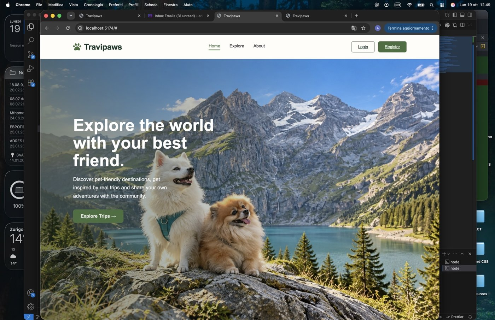

### Explore catalog

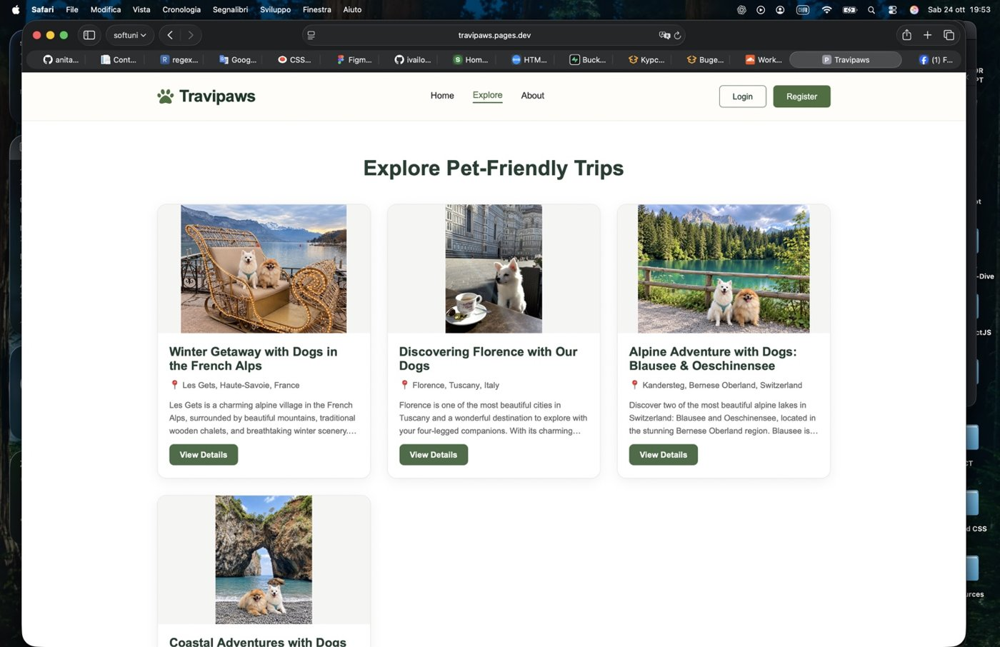

### Trip details and photo gallery

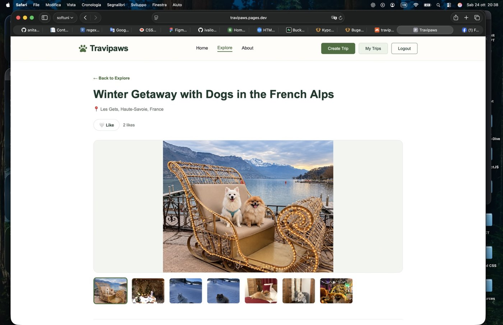

### Login

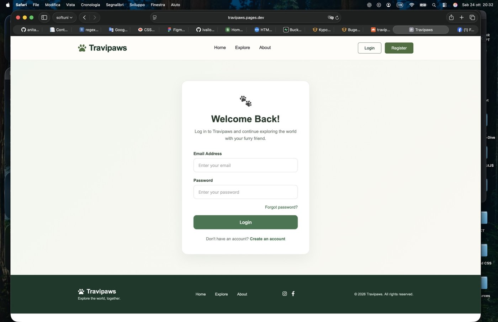

### Register

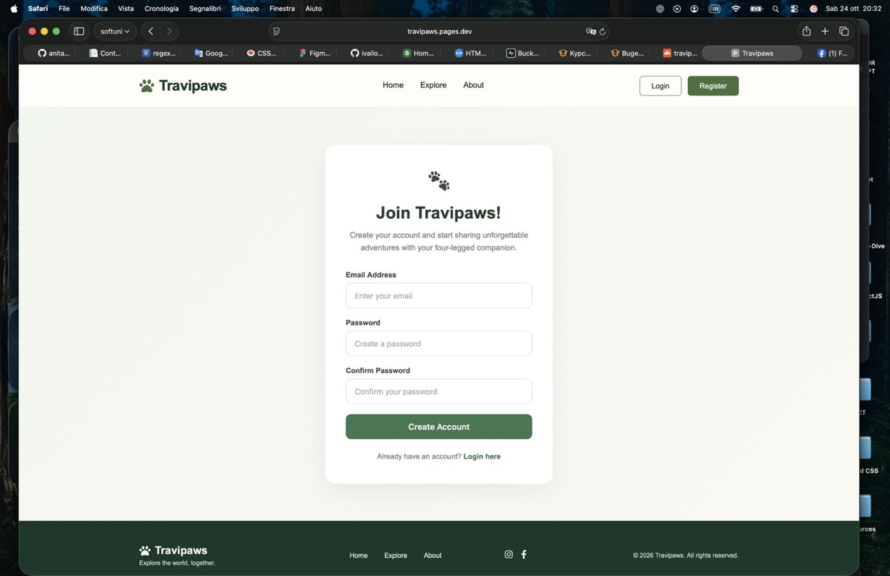

### Create Trip

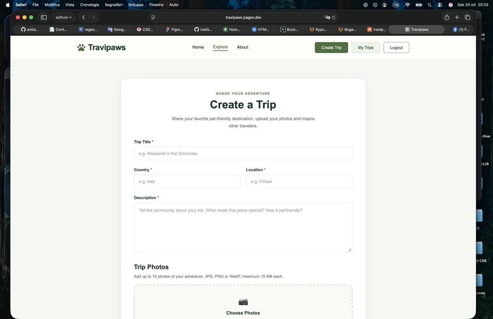

### My Trips

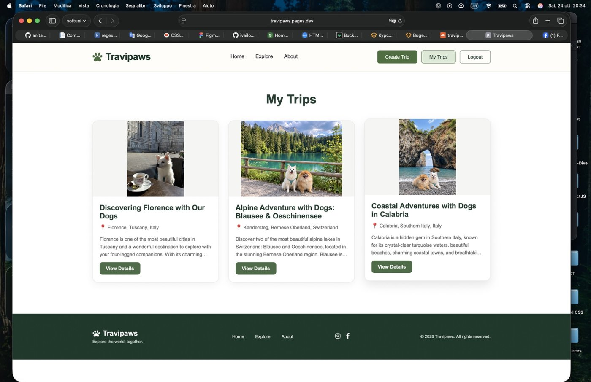

### Edit Trip

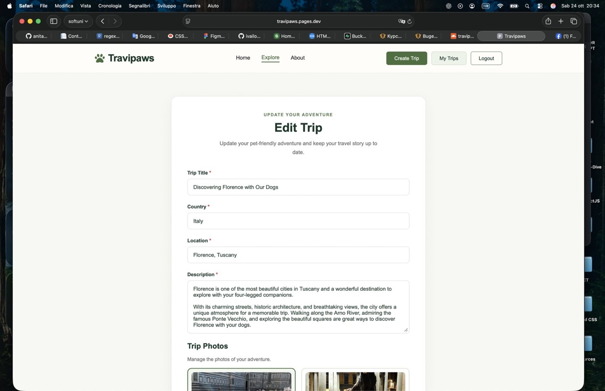

### Delete confirmation

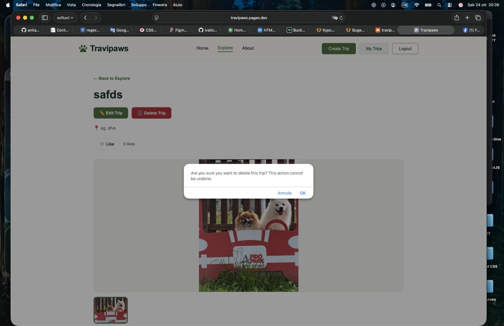

### About

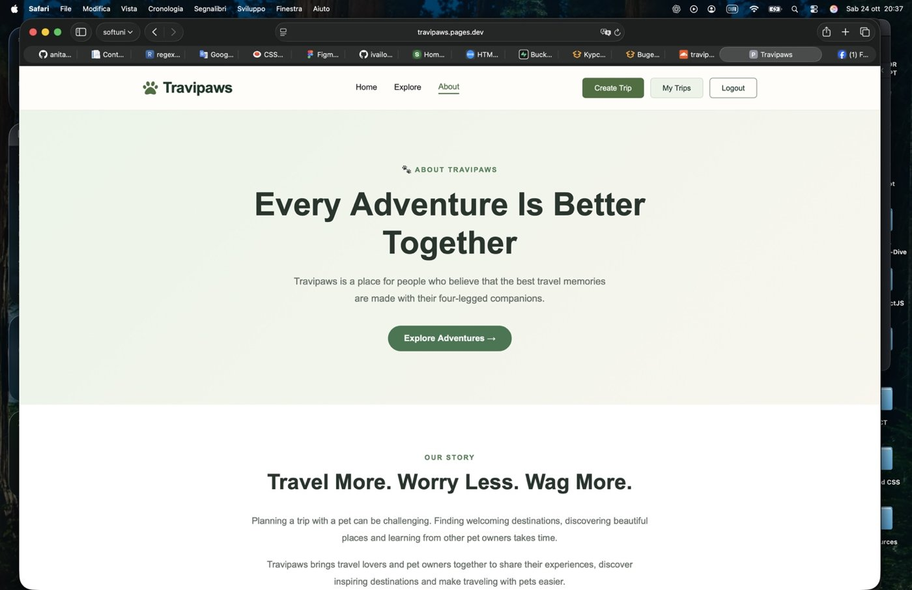

### Forgot Password

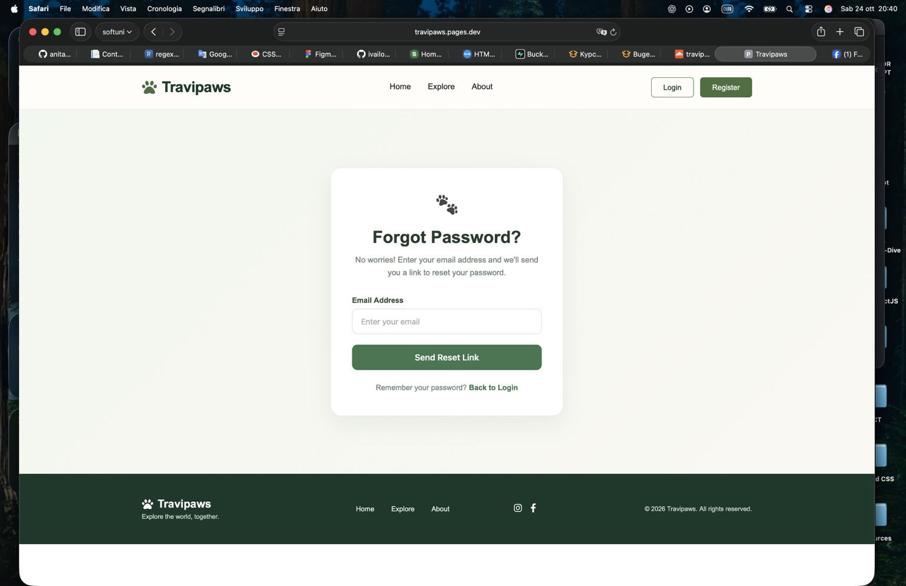

### Reset Password

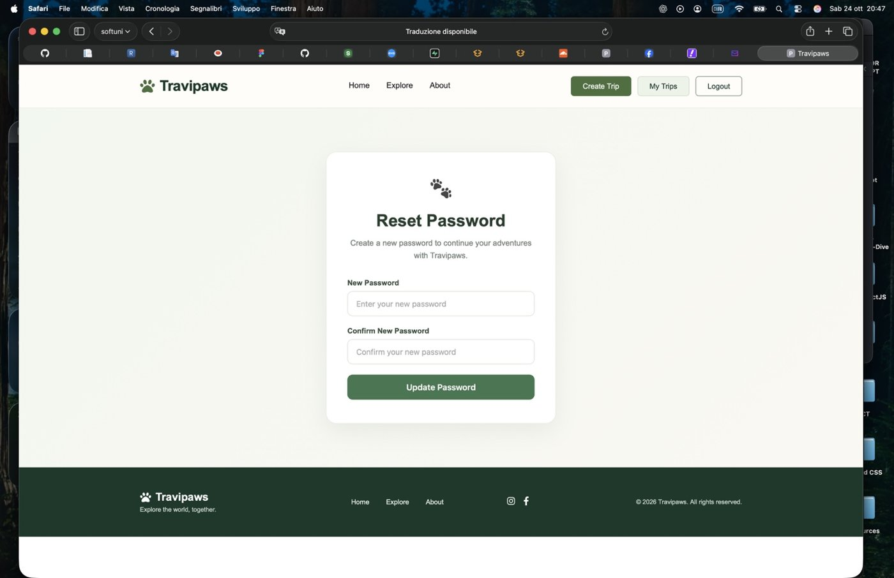
